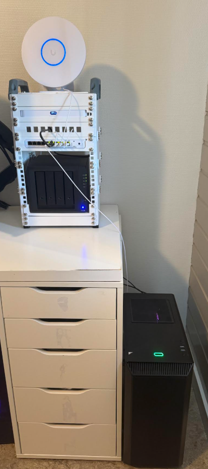
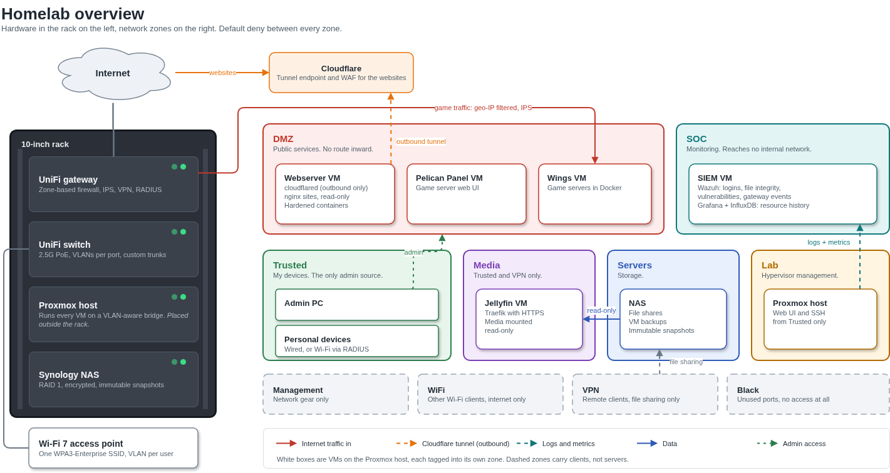

# Homelab

A small homelab in a 10-inch rack, built to learn how to run services the way a security team would want them run: segmented, least privilege, logged and reproducible.

Every project has its own folder with a write-up of what it does and why each security choice was made. Borrow whatever is useful.

All parts are 3d printed. Proxmox server on the right.

## Principles

- **Default deny.** Every network is its own firewall zone, and nothing crosses between zones unless a rule allows that one service.
- **Nothing internal faces the internet.** Public services live in an isolated DMZ. Websites go out through an outbound tunnel, so they need no open ports.
- **Least privilege everywhere.** Read-only mounts, scoped API tokens, separate admin accounts, and containers without root or capabilities.
- **Watch it all.** Servers and the gateway send their logs to a SIEM, and resource use is graphed over time.
- **Reproducible.** Pinned versions, scripts that are safe to run again, and infrastructure as code where it pays off.
- **No secrets in Git.** Tokens, keys and addresses live in local `.env` files outside the repository.

## Overview

Edit the diagram in [draw.io](docs/homelab-overview.drawio).

## Projects

| Project | What it is | 
| --- | --- | 
| [Network](network/VLAN.md) | Segmented UniFi network with a [zone-based firewall](network/FIREWALL.md), [RADIUS Wi-Fi](network/WiFi.md) and [OpenVPN](network/OpenVPN.md)
| [NAS](nas/NAS.md) | Synology NAS with an encrypted RAID 1 volume and immutable snapshots
| [Wazuh](siem/SIEM.md) | SIEM for logins, file integrity, vulnerabilities and gateway security events 
| [Grafana](grafana/GRAFANA.md) | Resource history for the Proxmox host and every VM, through InfluxDB 
| [Jellyfin](jellyfin/JELLYFIN.md) | Media server behind Traefik, with the library mounted read-only from the NAS 
| [Game servers](gameservers/GAMESERVERS.md) | Pelican Panel and Wings in the DMZ, running Minecraft 
| [Webserver](webserver/WEBSERVER.md) | Static websites in hardened containers, published through a Cloudflare Tunnel
| [Proxmox VM module](proxmox/) | OpenTofu module for Debian VMs from a verified cloud image
| [Tooling](tools/TOOLING.md) | Podman toolbox with pinned versions of every infrastructure tool 
| [Kubernetes](kubernetes/KUBERNETES.md) | Talos Linux cluster with Flux GitOps, kept for a rebuild 

## Hardware

| Part | Role |
| --- | --- |
| UniFi gateway | Routing, firewall, VPN and RADIUS |
| UniFi switch and Wi-Fi 7 access point | Wired and wireless access, VLANs tagged per port |
| Synology NAS | Storage and backups |
| Proxmox host | Virtual machines for every service |
| 10-inch rack | Holds it all together |

## Stack

UniFi · Proxmox VE · Docker Compose · Traefik · Cloudflare Tunnel · Let's Encrypt · Wazuh · InfluxDB · Grafana · Jellyfin · Pelican · OpenTofu · Talos Linux · Flux · Podman